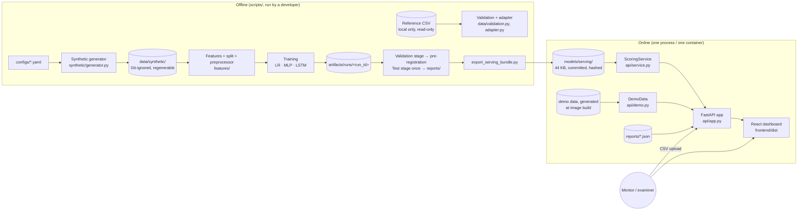
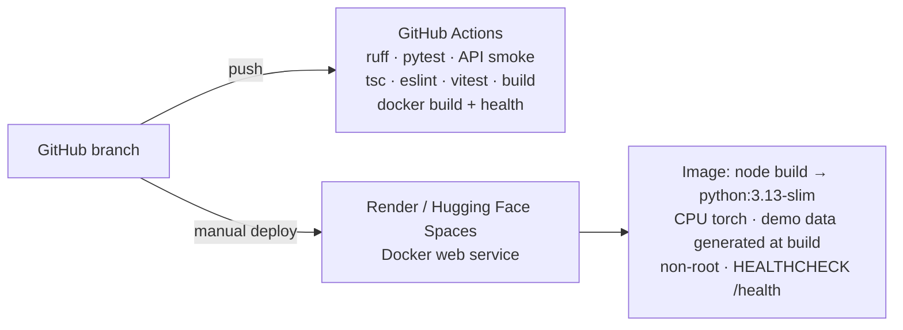

# Architecture

ScholarTrack has one offline part (data → training → evaluation → a frozen serving bundle) and
one online part (a FastAPI service that loads the bundle and serves a React dashboard). The
two meet only through `models/serving/`, so the website can never train, re-select or peek at
test data.

## 1. Big picture



## 2. Request flow: batch prediction

```mermaid
sequenceDiagram
  participant B as Browser (BatchPage)
  participant A as FastAPI /api/predict/batch
  participant L as loader + validation
  participant AD as adapter
  participant S as ScoringService
  B->>A: multipart CSV (≤ 2 MB, ≤ 5,000 rows)
  A->>L: read_college_csv (size / row limits, header check)
  L-->>A: frame + ValidationReport (error / invalid / warning)
  A->>AD: adapt_college_frame → semesters + subjects (opaque student_key)
  AD-->>A: tables + id_map (in memory only)
  A->>S: score(latest semester per student)
  S->>S: features → preprocessor (train medians/means) → LR, MLP, LSTM
  S->>S: risk score = round(100·p), band, concept-group explanation, suggestions
  S-->>A: predictions keyed by student_key
  A-->>B: JSON: summary, issues, predictions (PRN restored from id_map)
  Note over A: logs contain counts only; nothing is written to disk
```

## 3. Components

| Layer | Module | Responsibility |
|-------|--------|----------------|
| Data | `data/loader.py` | Safe CSV reading: size and row limits, BOM, duplicate-header check |
| | `data/validation.py` | Schema and range checks; every problem becomes an `Issue` with a severity |
| | `data/adapter.py` | Wide college CSV → long internal tables; PRNs replaced by opaque keys |
| | `targets.py` | Next-semester label (1 / 0 / unknown) from the following semester's marks |
| | `synthetic/generator.py` | Latent-variable generator of a multi-cohort dataset in the college format |
| Features | `features/build.py` | 15 snapshot features (+3 missing flags); per-semester sequences for the LSTM |
| | `features/split.py` | 70/15/15 split **by student**, stratified by entry year |
| | `features/preprocess.py` | Imputation and scaling fitted on training rows only; stored as JSON |
| Models | `models/baselines.py` | Majority baseline; logistic regression stored as JSON |
| | `models/networks.py` | MLP; LSTM over packed variable-length sequences |
| | `models/artifacts.py` | Save/load with hashes; `torch.load(weights_only=True)` |
| Evaluation | `evaluation/*` | Metrics, calibration (Platt vs none by grouped CV), thresholds, bootstrap CIs, plots |
| Risk | `risk.py`, `configs/risk_bands.yaml` | Probability → score 0–100 → band |
| Explanation | `explain.py`, `configs/recommendations.yaml` | Concept-group perturbation vs a typical student; rule-based supportive suggestions |
| API | `api/app.py` and friends | Endpoints, limits, error format, SPA hosting, optional history |
| Frontend | `frontend/src/` | Six pages; typed API client; charts with accessible palette |

## 4. API surface

| Method | Path | Purpose |
|--------|------|---------|
| GET | `/health`, `/api/health` | Liveness; reports whether the model bundle and demo data loaded |
| GET | `/api/model-info` | Run ID, features, thresholds, bands, versions |
| GET | `/api/metrics` | Frozen test metrics and curves (from `reports/`) |
| GET | `/api/overview` | Dashboard tiles and band counts for current demo students |
| GET | `/api/students?q=&band=&limit=&offset=` | Current demo students with scores |
| GET | `/api/students/{prn}` | One demo student: prediction, explanation, history |
| GET | `/api/analytics?cohort=&semester=` | Aggregates; groups < 10 records suppressed |
| POST | `/api/predict` | JSON records in the college format → predictions |
| POST | `/api/predict/batch` | CSV upload → validation report + predictions |
| GET | `/api/history` | Prediction counts (only when history is enabled) |
| GET | `/api/docs` | Interactive OpenAPI documentation |

Errors always have the shape `{"error": {"code", "message", "details"}}`.

## 5. Why these boundaries

- **Frozen bundle.** The online service loads exactly what was evaluated: file hashes in
  `bundle.json` are verified at start-up; if one differs, `/health` reports `degraded` and no
  scores are served. The demo data's manifest hash must also match the one the models were
  trained with; if not, the demo pages are switched off (`demo_data_loaded: false`) while
  uploads keep working.
- **Opaque keys.** Everything after the adapter works with `S000001`-style keys; the PRN is
  re-attached only in the response the user asked for. Names are never read into a model input.
- **Same code path for one and many.** `POST /api/predict` converts records to CSV text and runs
  the batch path, so single and batch predictions cannot diverge.
- **Config over code.** Thresholds, bands, suggestions, curriculum and generator parameters are
  YAML files; changing a band does not need retraining.
- **One container.** The API serves the built dashboard, so there is no CORS set-up and a single
  URL to deploy.

## 6. Deployment shape



See [`DEPLOYMENT_GUIDE.md`](DEPLOYMENT_GUIDE.md).
