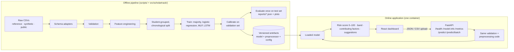

# ScholarTrack — Project Plan

**Project:** ScholarTrack — Detecting Students at Risk of Falling Behind (Project Sheet PS 6)
**Techniques:** Multilayer Perceptron (MLP) and Long Short-Term Memory (LSTM)
**Status of this document:** Living plan. Items marked *(proposed)* need your approval before
they are implemented. Nothing in this file is an experimental result.

---

## 1. What we are building

A reproducible, tested, deployable system that estimates the probability that a student will
experience a *defined* academic difficulty in a *future* assessment period, and presents it as
an **Academic Risk Score (0–100)** with an explanation and supportive suggestions.

The system has four parts:

1. **Offline ML pipeline** — data adapters → validation → feature engineering → leakage-safe
   splitting → baselines, MLP, LSTM → calibration → evaluation reports.
2. **Inference API** (FastAPI) — loads saved artefacts; never retrains during requests.
3. **Web dashboard** (React + TypeScript) — overview, student analysis, batch CSV prediction,
   analytics, model evaluation, methodology.
4. **Documentation** — report, viva preparation, learning notes, data dictionary, experiment log.

Out of scope: authentication/user accounts (unless a later phase justifies it), any real
student records, automated decisions about students.

---

## 2. Milestones

Each milestone ends with: tests/checks run, results reported (including failures), docs and
`TASKS.md` updated.

| # | Milestone | Phases | Verification |
|---|-----------|--------|--------------|
| M1 | Workspace inspection, plan, dataset research, repo scaffold | 0, 1 | Research docs cite sources; repo-hygiene tests pass; no data tracked by Git |
| M2 | Reference CSV inspection, schema + validation module, data-quality report | 2 | Validation unit tests; report generated from code, not by hand |
| M3 | Target definition (approved by you) | 3 | Written definition, leakage analysis, sign-off recorded |
| M4 | Synthetic college-format generator (+ real-dataset loader if approved) | 4 | Reproducibility test (same seed ⇒ identical file hash); schema/range tests |
| M5 | Feature pipeline, splitting, data dictionary | 5 | Fit-on-train-only tests; group/chronological split tests; train/serve consistency test |
| M6 | Baselines, MLP, LSTM training | 6 | Training smoke tests; saved artefacts reload and reproduce predictions |
| M7 | Calibration, risk score, full evaluation suite | 7 | Metric unit tests vs hand-computed cases; JSON + plots generated |
| M8 | Explanations and supportive recommendations | 8 | Explanation tests (sign/ordering on constructed inputs) |
| M9 | FastAPI backend | 10, 11 | API tests: valid/invalid single + batch, limits, error format |
| M10 | React dashboard | 9 | Type check, lint, component tests, end-to-end smoke against real API |
| M11 | CI, clean-install test, Docker | 12, 14 (prep) | GitHub Actions green on a pushed branch |
| M12 | GitHub publication and deployment | 13, 14 | Push with your approval; public health check + live sample prediction |
| M13 | Final documentation, viva prep, acceptance checklist | 15, 16 | Every checklist item checked against evidence |

---

## 3. Architecture (planned)

Key principle: **training and inference import the same preprocessing code and the same
fitted preprocessor object**, so a CSV uploaded in the browser is transformed exactly as the
training data was.

---

## 4. Technology stack *(proposed)*

| Layer | Choice | Why |
|-------|--------|-----|
| Language | Python ≥ 3.11 (tested on 3.13 locally, 3.12 in CI) | Ecosystem for ML; both versions supported by all libraries below |
| Data | pandas, NumPy | Standard, well documented |
| Classical ML + metrics | scikit-learn | Logistic regression, majority baseline, calibration, metrics, permutation importance |
| Neural networks | PyTorch (CPU) | One framework for both the MLP and the LSTM; explicit control of early stopping, masking and dropout |
| API | FastAPI + Pydantic v2 + Uvicorn | Typed request/response schemas and auto-generated API docs |
| Frontend | React + TypeScript + Vite + Tailwind CSS + Recharts | Requested stack; Vite keeps the build simple |
| Storage | SQLite, **off by default** | Only if prediction history is needed; trivially disabled |
| Python tooling | uv (lockfile), ruff (lint + format), mypy, pytest | Fast, reproducible, one lockfile |
| Frontend tooling | npm lockfile, ESLint, Prettier, `tsc --noEmit`, Vitest + React Testing Library | Standard React checks |
| CI | GitHub Actions | Requested; runs on every push |
| Deployment | One Docker image: FastAPI serves the built frontend | One URL, no CORS between services, one health check. Host chosen in Phase 14 after checking current limits |

**Trade-off noted:** serving the frontend from FastAPI (one service) is simpler and more
reliable for a student project than hosting frontend and backend separately; the cost is that a
frontend change requires rebuilding the image. We can split them later if needed.

**Known dependency risk:** PyTorch wheels from PyPI on Linux pull in large CUDA libraries.
For CI and deployment we will use CPU-only wheels, or export the trained networks to ONNX and
serve them with `onnxruntime` if image size or memory limits require it (decided in Phase 14).

---

## 5. Dataset strategy *(proposed — needs your approval)*

Research (see `research/DATASET_RESEARCH.md`) found **no public dataset that matches the
college format** (semester SGPA + subject-wise CIE/ETE/termwork + attendance) **and** has an
observed future outcome. The best real-outcome candidate is UCI *Predict Students' Dropout and
Academic Success* (4,424 students, Portugal, CC BY 4.0, observed graduation/dropout status).
The best genuinely longitudinal candidate is OULAD (32,593 students, daily activity, CC BY 4.0),
but it is a UK distance-learning dataset with a very different schema.

**Recommended: a two-track design.**

| Track | Data | Purpose | Models | Honest label in the app |
|-------|------|---------|--------|--------------------------|
| **S — College format** (primary for the app) | Synthetic multi-semester data generated to match the schema of your reference CSV | Powers single-student and batch prediction in *your* college's format; genuine semester sequences for the LSTM | Majority, logistic regression, MLP, LSTM | "Synthetic demonstration — metrics measure agreement with a documented label-generating rule, not real-world predictive ability" |
| **R — Real-outcome benchmark** | UCI Dropout & Academic Success | Shows that the same methodology works on an observed outcome | Majority, logistic regression, MLP; LSTM only as a clearly limited 2-step experiment | "Real observed outcomes from one Portuguese institution; not transferable to your college without local validation" |

Alternatives you could choose instead:

- **Synthetic only (Track S):** less work, but every number in the project would be synthetic.
- **Two-track + OULAD:** adds a real longitudinal LSTM experiment (weekly activity sequences).
  It is the strongest LSTM evidence but the largest dataset (≈10.7 M activity rows) and a
  different domain. Suggested only as a stretch goal.

Network note: the environment currently blocks `archive.ics.uci.edu` and
`analyse.kmi.open.ac.uk`, so Track R needs that host allowed (or the file supplied by you).
I will not substitute an unofficial mirror without your approval.

---

## 6. Prediction problem *(preliminary — finalised in Phase 3 after inspecting your CSV)*

### Track S (college format)

| Element | Proposed definition |
|---------|---------------------|
| Prediction unit | One student at the end of semester *t*, after semester *t* results are known |
| Horizon | Semester *t + 1* |
| Positive class ("at risk") | In semester *t + 1*: SGPA below a configurable threshold **or** at least one subject not passed. **Thresholds are illustrative placeholders, not official rules** — I will use your college's documented rules if you can share them |
| Negative class | Neither condition holds in semester *t + 1* |
| Features allowed | Only information recorded up to the end of semester *t*: past SGPAs, attendance, CIE/ETE/termwork of semester *t* and earlier, trends |
| Features forbidden | Anything from semester *t + 1*; names; PRNs; any pre-computed "risk" column |
| Rows that cannot be labelled | A student's latest semester (no *t + 1* yet) — used for inference only, never for training/evaluation |
| What the model cannot establish | Causes of difficulty, motivation, effort, personal circumstances, or real-world accuracy (the label is synthetic) |

An alternative **in-semester early-warning** variant (predict semester *t*'s outcome mid-way,
using attendance and CIE only, with ETE excluded because it *is* the outcome) is a candidate
extension; we will pick one primary task in Phase 3.

### Track R (UCI, if approved)

| Element | Proposed definition |
|---------|---------------------|
| Prediction unit | One student at the end of the 1st semester (variant: end of 2nd semester) |
| Horizon | End of the normal duration of the degree (as defined by the dataset authors) |
| Positive class | Did **not** graduate within the normal duration (`Dropout` or still `Enrolled`) |
| Sensitivity analysis | Dropout only vs. Graduate |
| Leakage checks | 2nd-semester fields in the 1st-semester model; timing of "tuition fees up to date" / "debtor" fields |

---

## 7. Academic Risk Score

- `risk_score = round(100 × p̂)`, where `p̂` is the model's **calibrated** probability of the
  positive class. Calibration (Platt scaling, isotonic regression or temperature scaling) is
  fitted on the validation set only and assessed with the Brier score and a reliability curve.
- Bands live in `configs/risk_bands.yaml` and can change without retraining. Demonstration
  defaults: **Low 0–29, Moderate 30–59, High 60–100** — not institutionally validated.
- The score is an *estimate for one student*; model accuracy is a *property of the model over
  many students*. The UI will never present one as the other.
- **Top-K risk capture** = (actual at-risk students among the K highest scores ÷ all actual
  at-risk students) × 100, reported with K and the counts involved, alongside precision@K.

---

## 8. Evaluation design

- Split **by student** (no student in more than one partition); for Track S, additionally hold
  out the latest synthetic cohort to mimic deployment on a future intake.
- Train / validation / test ≈ 70 / 15 / 15. Hyper-parameters, calibration and decision
  thresholds are chosen on validation; the test set is used once for the final report.
- Metrics: accuracy, precision, recall, F1, confusion matrix, ROC-AUC + curve, PR-AUC + curve,
  Brier score, calibration curve, class distribution, top-K capture, train/inference time.
- Every number comes from saved held-out predictions; reports are generated by code.

---

## 9. Acceptance criteria (summary)

The project is complete only when every item in the Phase 16 checklist in `TASKS.md` is
checked **with evidence** (a passing test, a generated report, a verified URL, or a commit).

---

## 10. Risks and unknowns

| Risk | Impact | Mitigation |
|------|--------|-----------|
| Reference CSV not yet available | Blocks Phase 2 and schema-matched synthetic data | Requested from you; Phase 1 work does not depend on it |
| Network policy blocks UCI / Open University hosts | Blocks Track R and OULAD downloads | You can allow the hosts in the environment settings; no unofficial mirrors without approval |
| No public dataset matches the college schema | Track S results are synthetic only | Clearly labelled; Track R provides a real-outcome benchmark |
| LSTM may not be justified on real data | UCI has only two semester steps | LSTM evaluated on genuine (synthetic) sequences; limitation documented |
| Synthetic label is too easy or too hard | Misleading metrics | Label generated from latent variables + noise, not from model features; difficulty checked with baselines |
| Official academic thresholds unknown | Target realism | All thresholds configurable and labelled illustrative; use your college's rules if provided |
| PyTorch size vs free hosting limits | Deployment may fail | CPU wheels or ONNX export; host chosen after checking current limits |
| Public GitHub repository | Privacy | No student-level files ever committed; enforced by `.gitignore` and an automated test |
| Ephemeral cloud container | Unpushed work can be lost | Commit after every milestone; push once you approve |
