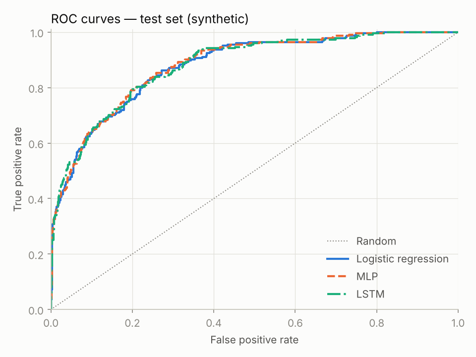
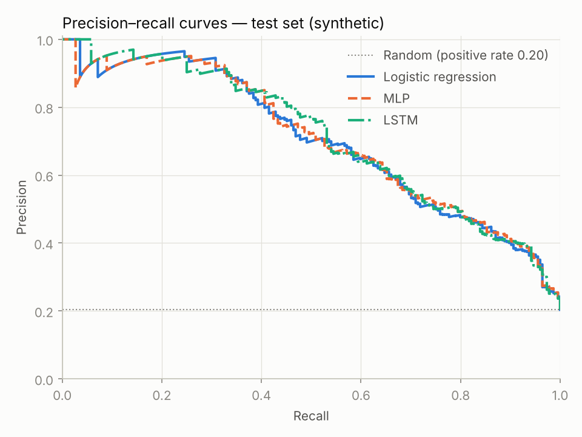
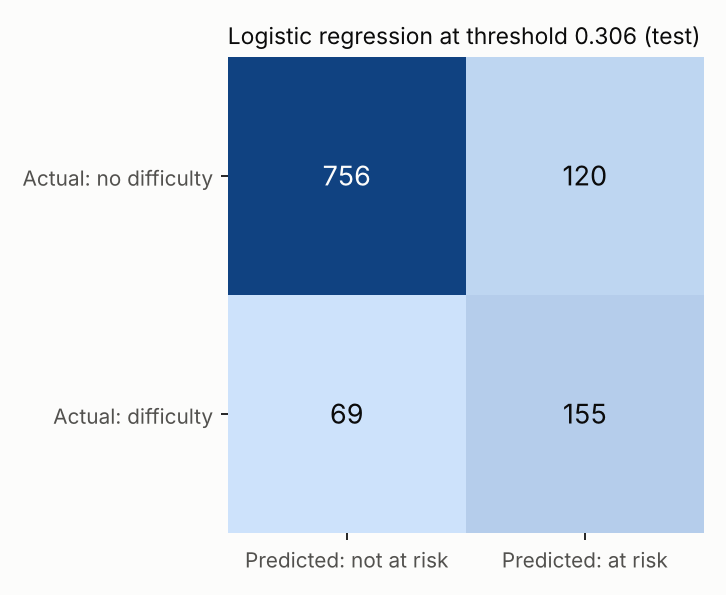
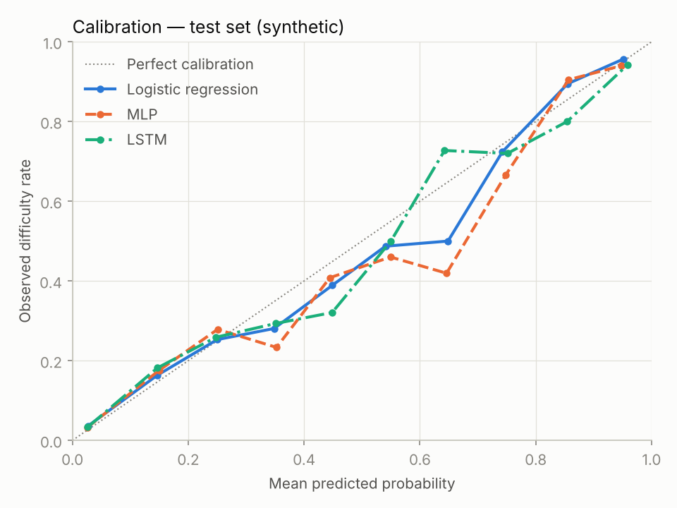
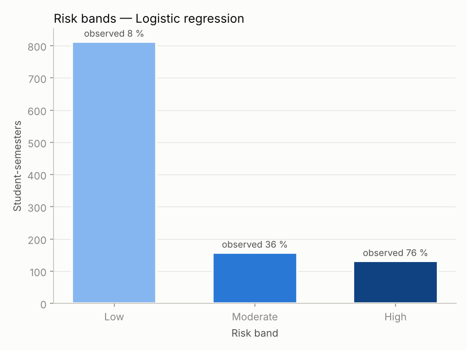

# Evaluation Report — Test Set

> Generated by `scripts/final_evaluation.py` for run `20261016T200932Z-8acaad7`. **Synthetic data**: every number measures agreement with the documented synthetic label process, not real-world predictive ability. Calibration, thresholds and the model choice were fixed on validation data *before* this test evaluation (`reports/model_selection.json`, committed beforehand).

## 1. Test set

1100 labelled student-semesters from 179 students never used for training or selection; positive (difficulty next semester) rate **20.4 %**.

## 2. Model selection (decided on validation)

| model | calibration | threshold | val log loss | val ECE | val F1 |
|---|---|---|---|---|---|
| Majority baseline | none | 0.207 | 0.4912 | 0.0141 | 0.324 |
| Logistic regression | none | 0.306 | 0.2615 | 0.0193 | 0.728 |
| MLP | none | 0.351 | 0.2636 | 0.0136 | 0.724 |
| LSTM | none | 0.349 | 0.2641 | 0.0164 | 0.735 |

Rule: lowest validation log_loss; models within 0.005 of the best are tied, and ties go to the simpler model (logistic_regression > mlp > lstm). Tied: Logistic regression, MLP, LSTM. **Chosen: Logistic regression.**

## 3. Probability and ranking metrics (95 % CI, bootstrap by student)

| model | ROC-AUC | PR-AUC | Brier | log loss | ECE |
|---|---|---|---|---|---|
| Majority baseline | 0.500 — | 0.204 — | 0.1622 — | 0.5054 — | 0.0035 |
| Logistic regression | 0.878 [0.840, 0.910] | 0.705 [0.587, 0.793] | 0.1013 [0.0840, 0.1187] | 0.3272 [0.2766, 0.3776] | 0.0219 |
| MLP | 0.881 [0.844, 0.913] | 0.707 [0.596, 0.792] | 0.1012 [0.0843, 0.1185] | 0.3265 [0.2760, 0.3767] | 0.0312 |
| LSTM | 0.880 [0.842, 0.912] | 0.714 [0.602, 0.798] | 0.1001 [0.0832, 0.1166] | 0.3247 [0.2761, 0.3748] | 0.0249 |

PR-AUC of a random ranking equals the positive rate (0.204). The majority baseline has no confidence interval: it is a constant.

 

### 3.1 Are the differences real? (chosen model minus other; 95 % CI)

| comparison | roc_auc | pr_auc | log_loss | brier |
|---|---|---|---|---|
| Logistic regression − MLP | -0.0031 [-0.0071, +0.0009] | -0.0020 [-0.0124, +0.0084] | +0.0007 [-0.0048, +0.0061] | +0.0001 [-0.0021, +0.0021] |
| Logistic regression − LSTM | -0.0017 [-0.0083, +0.0053] | -0.0089 [-0.0300, +0.0138] | +0.0025 [-0.0084, +0.0116] | +0.0012 [-0.0024, +0.0043] |

An interval that contains 0 means the test data cannot distinguish the two models on that metric. For log loss and Brier, negative favours the chosen model.

## 4. Decisions at the validation-chosen threshold

| model | threshold | accuracy | precision | recall | F1 | specificity | flagged |
|---|---|---|---|---|---|---|---|
| Majority baseline | 0.207 | 0.204 | 0.204 — | 1 — | 0.338 — | 0 | 100.0 % |
| Logistic regression | 0.306 | 0.828 | 0.564 [0.472, 0.644] | 0.692 [0.597, 0.771] | 0.621 [0.530, 0.697] | 0.863 | 25.0 % |
| MLP | 0.351 | 0.829 | 0.568 [0.476, 0.650] | 0.674 [0.575, 0.756] | 0.616 [0.524, 0.693] | 0.869 | 24.2 % |
| LSTM | 0.349 | 0.840 | 0.595 [0.502, 0.680] | 0.670 [0.566, 0.752] | 0.630 [0.538, 0.708] | 0.884 | 22.9 % |

Accuracy is misleading with imbalanced classes: predicting "no difficulty" for everyone would already be 79.6 % accurate. The majority baseline's threshold flags everyone (recall 1, precision = the positive rate); its F1 is the floor any useful model must beat.

Confusion matrix of the chosen model (Logistic regression): TP 155, FP 120, FN 69, TN 756.

## 5. Top-K risk capture (K = 110, 10 % of test student-semesters)

| model | K | actual positives in top K | all actual positives | capture % | precision@K % |
|---|---|---|---|---|---|
| Majority baseline | 110 | 25 | 224 | 11.2 — | 22.7 |
| Logistic regression | 110 | 89 | 224 | 39.7 [33.6, 46.2] | 80.9 |
| MLP | 110 | 91 | 224 | 40.6 [34, 46.6] | 82.7 |
| LSTM | 110 | 92 | 224 | 41.1 [34.8, 47.5] | 83.6 |

Capture = positives found among the K highest risk scores ÷ all positives × 100. With K = 110 and 224 positives, the maximum possible capture is 49.1 %. It is a ranking measure for limited mentoring capacity, not accuracy.

## 6. Calibration

| bin | count | mean_predicted | observed_rate |
|---|---|---|---|
| 0.0–0.1 | 582 | 0.027 | 0.036 |
| 0.1–0.2 | 147 | 0.146 | 0.163 |
| 0.2–0.3 | 91 | 0.250 | 0.253 |
| 0.3–0.4 | 57 | 0.348 | 0.281 |
| 0.4–0.5 | 54 | 0.449 | 0.389 |
| 0.5–0.6 | 39 | 0.541 | 0.487 |
| 0.6–0.7 | 36 | 0.649 | 0.500 |
| 0.7–0.8 | 29 | 0.742 | 0.724 |
| 0.8–0.9 | 19 | 0.855 | 0.895 |
| 0.9–1.0 | 46 | 0.951 | 0.957 |

Reliability table for Logistic regression (test). ECE = expected calibration error: the count-weighted average gap between predicted and observed rates.

## 7. Risk bands (chosen model, test set)

| band | range | count | observed_rate |
|---|---|---|---|
| Low | 0–29 | 812 | 0.083 |
| Moderate | 30–59 | 157 | 0.363 |
| High | 60–100 | 131 | 0.763 |

Bands are demonstration defaults (`configs/risk_bands.yaml`). If the scores are calibrated, the observed rate in each band should fall inside its score range.

## 8. Cost

| model | training seconds (chosen setting) | inference ms per 1,000 rows |
|---|---|---|
| Majority baseline | — | 0.13 |
| Logistic regression | — | 0.23 |
| MLP | 1.8 | 1.96 |
| LSTM | 5.8 | 4.06 |

CPU only (4 threads). Timings vary by machine; they are shown for relative comparison.
